# Glomus

*Upward, not northward.*

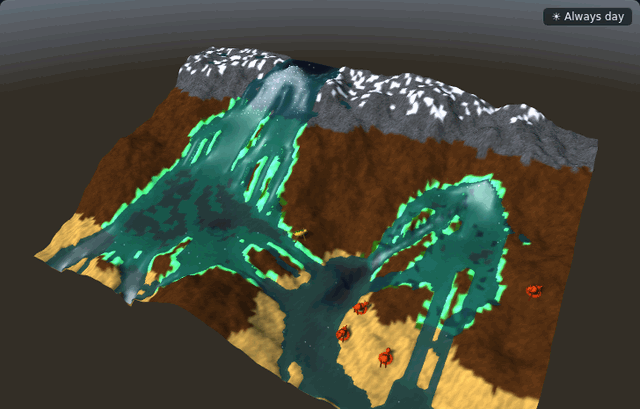

A living landscape, seen from above, that a local model reshapes and reprograms on your whims.

Point at a spot and say what you want: *carve a stream from here into the lake*, *make the stones here
sweat water*, *a floodgate that bursts every 30 seconds*, *let glowing moss creep along the banks*. A model
running on your own machine works on a copy of the world: it looks closely at the ground, previews its plan
in a short simulation, fixes what the preview shows is wrong, and commits. What it commits is a **skein**:
new materials, edits to the ground, and **threads**, small rules that keep running in the world. The world's
own nature (the spring, meadows, snow on the peaks) is written in threads too, so a whim can extend it,
compete with it or switch it off.

Nothing has to be useful. Skeins pile up and tangle: moss follows the floodgate's water, a channel fills with
silt, rain turns the peaks white and the meltwater finds the new streams.

*Glomus* is Latin for a ball of thread; it is also a genus of fungi whose hidden networks feed the plants
above them.

## Play

Double-click **Play Glomus.vbs**, or run `npm start`. It serves the game at http://127.0.0.1:8840/ and starts
the local model if nothing answers at the configured address.

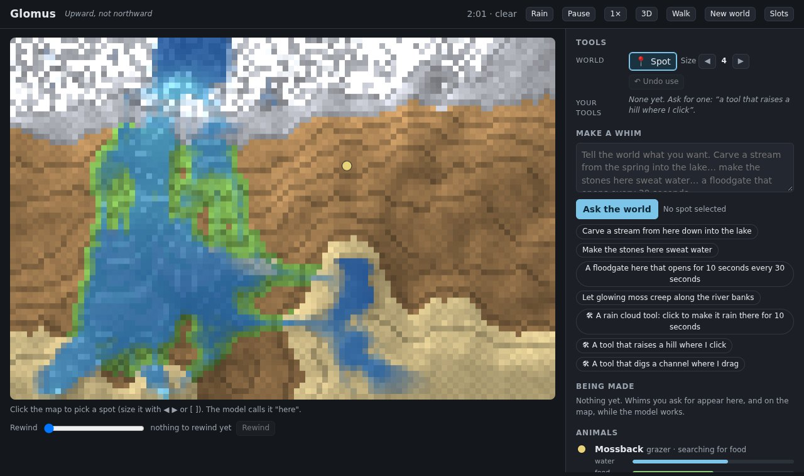

- **Click** the map to choose a spot. The model calls it "here". Size it with **◀ ▶** in the palette above the
  map, or with **[** and **]**.
- **Ask the world** (Ctrl+Enter) queues a whim. While the model works, its spot shows a moving dashed ring,
  and its card lists each step: what it looked at, what its preview showed, and when it finished.

| Ask | After |
| --- | --- |
|  | 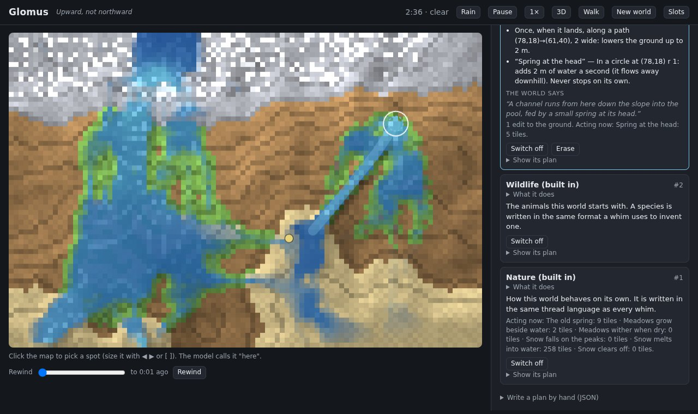 |

*A whim from asking to done: the spot and the words, then the new channel and its skein's card.*
- **The world can say no.** When a whim asks for something Glomus doesn't have, such as a double-click, a key,
  days of time or creatures, the card says *Can't do* and offers the closest thing it can make, with
  **Apply** and **No thanks**. Nothing is applied until you choose. Sometimes it just explains why it can't.
- **Skeins** lists every whim. Each card leads with **What it does**, a description generated from the plan
  itself, so it can't promise more than the plan does. The model's own words come below it.
  - *Switch off* pauses a skein's threads and tools.
  - *Erase* stops them and takes back what they did to the ground, leaving later whims' changes alone.
    It doesn't replay the world; *Rewind* does that.

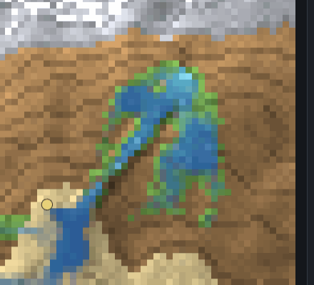

*A floodgate that bursts every 30 seconds: a thread that keeps running in the world.*
- **Rewind** goes back up to three minutes. **Rain**, **Pause** (Space) and **speed** are in the header.
- *Write a plan by hand* applies a plan in the same JSON the model writes.
- **Slots** (header) saves this world to a named slot the local server keeps, or opens one. See
  [World slots](#world-slots).

### World slots

A slot is a named world the local server keeps in `workspace/worlds/<name>.json`, in `world.js`'s own save
format (version 1), with who last wrote it and when. Another program on this computer that holds the access
token in `workspace/token.txt` can fetch a slot, change the world and write it back, so one world can be
carried between Glomus and that program.

| Route | What it does |
| --- | --- |
| `GET /api/worlds` | every slot's `name`, `rev`, `savedAt`, `savedBy` and `tick` |
| `GET /api/worlds/<name>` | the same, with its `world` |
| `POST /api/worlds/<name>` | `{world, by, base}` writes it. `base` is the `rev` being replaced, or `null` for a new slot |

Every route needs the `X-Glomus-Token` header and a `Host` of `127.0.0.1` or `localhost`, like the rest of
`/api`. Names are 1 to 40 lowercase letters, digits, `-` or `_`. A world must load in `world.js` and stay under
1 MB, and there are at most 64 slots. A write whose `base` isn't the slot's current `rev` is refused with 409
and the slot's current details, so two writers can't overwrite each other unawares; the page asks you to press
again. The world a write replaces is kept in `workspace/worlds/previous/<name>.json`, and opening a slot on the
page keeps the world it replaces, with **Put back the world you had**. Nothing deletes a slot.

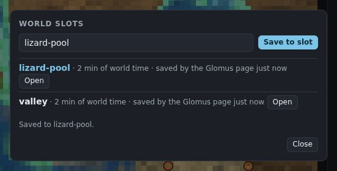

### Tools

Ask for a tool and it appears in **Your tools**, in the palette above the map. Examples: *a tool that raises a
hill where I click*, *a rain cloud I can drop anywhere*, *a tool that digs a channel where I drag*. The 🛠
ideas under the whim box are tool ideas.

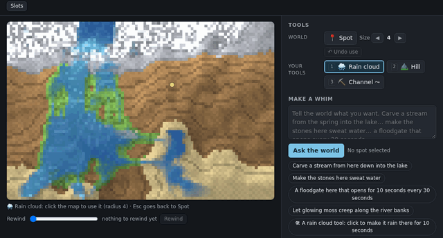

*Tools from whims: a rain cloud clicked onto the slope, then a channel dragged across it.*

- Pick a tool, or press its number key **1–9**, then **click** the map to use it. A tool marked ⤳ is a drag
  tool: **drag** across the map instead. **Escape** goes back to choosing spots.
- Nothing happens until you use a tool. Each use can change the ground once, keep acting there, or both,
  with its timing counted from that use.
- A ring marks each use that's still at work. The note beside a new use says what it's doing: *acting*,
  *starts in 8 s*, *waiting for rain*, *holding at 6 m*, *the water has arrived*.
- **↶ Undo** (Ctrl+Z) takes back your last use. It stops that use and takes back what it did to the ground,
  but water it added stays.
- To change a tool you have, ask (*make my rain cloud rain twice as hard*). The new one takes the old one's
  place in the palette, and the old tool's earlier uses keep going.
- A tool's card has **Remove** to take it off the palette (what it made stays) and **Put back** to return it.
- A `?seed=` page starts its world over on every reload, tools included. Your own world at
  http://127.0.0.1:8840/ is saved in the browser.

### Animals

Every new world starts with **Mossback**, a grazer. It lives on its own:
- it drinks next to water and eats meadow, which leaves soil where it grazed;
- it flees floods and avoids snow;
- it sees 12 tiles around it;
- it dies if it goes too long without water or food.

You can't steer it. You can only change the land around it.

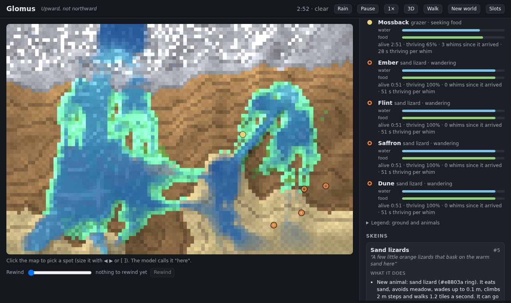

- The **Animals** panel shows each animal's water and food, what it's doing, and two scores. Thriving % rewards
  a heavy hand; seconds thriving per whim rewards a light touch. Hover a row to find the animal on the map, or
  hover the animal itself.
- Whims can invent species and release them: *a few little orange lizards that bask on the warm sand here*. A
  species is data: its look (a colour and a pattern), what it eats and avoids, how deep it wades, how high it
  climbs, its speed, and how long it lasts without water or food.
- **Legend** (under Animals) lists every kind of ground and every species, with counts.
- Animals can't fly, swim, breed, form herds or hunt yet. Whims that ask for those come back as proposals. See
  `docs/CREATURES.md`.

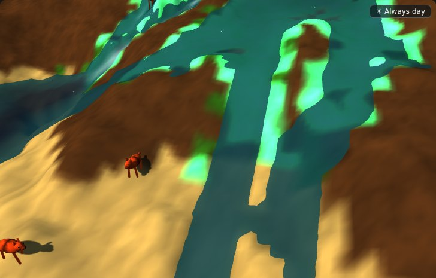

*Sand lizards from a whim, in 3D.*

### In 3D

Press **3D** in the header (or **V**) to see the same world in 3D, drawn with
[Strata](https://github.com/Preponderous-Software/strata). Drag to turn it, scroll or pinch to zoom, and
right-drag or Shift-drag to pan. It shows what the map shows:

- Tapping the land picks a spot or uses a click tool. With a drag tool picked, a drag draws the stroke over
  the land and uses the tool along it, as on the map; Alt-drag or middle-drag then turns the view, and on a
  phone two fingers still pan and zoom (pick Spot to turn it with one finger).
- Hovering reads out the tile or animal under the pointer, with the tool's brush ring.
- Tool uses still at work (bright while acting, faint while holding), the skein you hover in the Skeins list,
  whims being made (waiting, working, needing your OK, fizzled), the flash after a use and its note.
- Rain, animals in their species' colour and pattern, and a × where one died.

The sun keeps the world's own clock: a day and night lasts six minutes of world time, with long shadows and a
warm light at dawn and dusk, moonlight and stars at night, and a greyer, dimmer light while it rains (the land
stays dark and wet for a while after). The button at the top right of the view, **Always day**, pins an
afternoon sun for when you'd rather just see; it remembers your choice. Up close the ground is drawn four times
finer than the map's tiles, with grass, rock, sand and snow each looking like themselves and soft, ragged edges
between them. Water is clearer in the shallows and darker in pools, glints in the sun and carries foam where
it runs fast. Animals have bodies (Mossback wears moss on its back), face where they're going and put their
heads down to eat and drink. Ground whose material glows (a whim's "glowing moss", say) lights up the night.

| Day | Night |
| --- | --- |
| 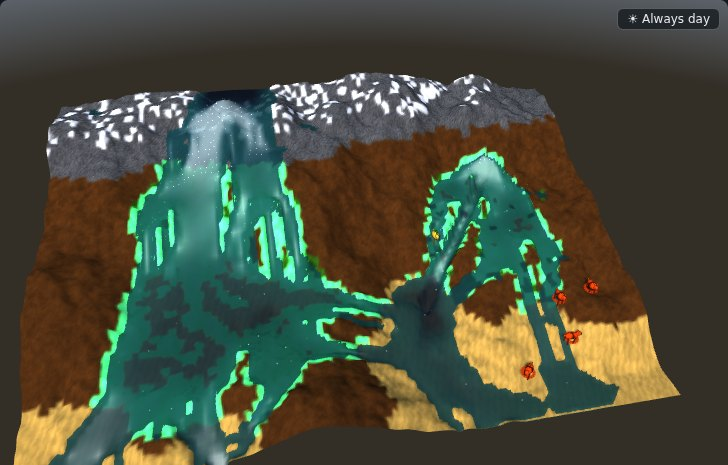 | 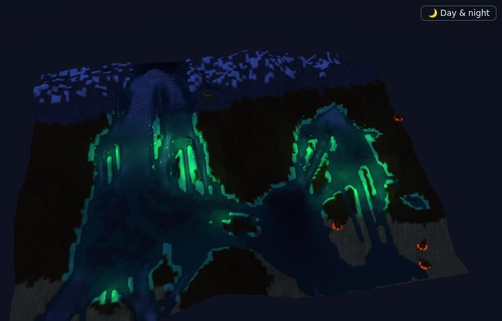 |

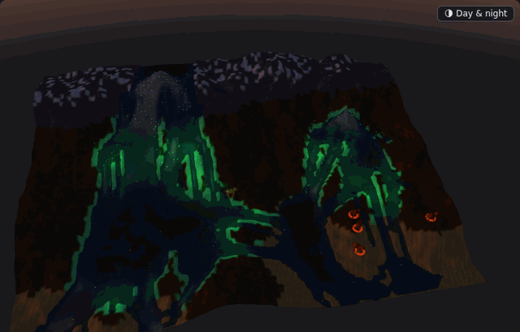

**Walk** (or **B**) puts you on the land as a visitor, seen from behind. **W A S D** or the arrows walk, **Q**
and **E** turn, **Shift** hurries, and dragging still turns the view. **C** switches to seeing through the
visitor's eyes and back. **R** puts the spot where you stand, or uses the picked tool there. You follow the
ground, wade slowly through shallow water, and are stopped by deep water and cliffs. On a phone a stick and two
buttons appear. The visitor is only a way of looking: the world and its animals don't know you're there.

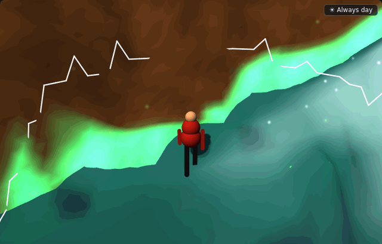

**Map** goes back to the flat view. http://127.0.0.1:8840/3d shows your saved world full-window and keeps it
living. That page only watches, so nothing there is saved.

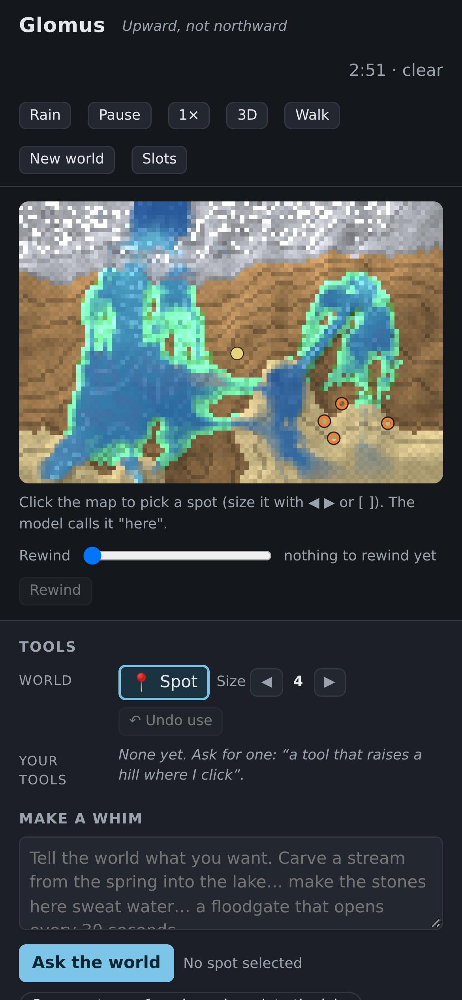

*At phone width.*

## The model

`config/model.json` names the model server. By default it starts llama.cpp's `llama-server` with Qwen3.8
27B (Q4_K_L) on port 8080, with the model's own chat template (`--jinja`) so tool calling works. Any
OpenAI-compatible server with tool calling (Ollama, LM Studio, vLLM) works if its `baseUrl` and `alias`
match; remove the `launch` section to use one that is already running.

To use another server without editing `config/model.json`, put the parts that differ in
`config/model.local.json`, which git ignores:

```json
{ "baseUrl": "http://my-gpu-box:8000/v1", "alias": "qwen-coder", "apiKey": "..." }
```

or set `GLOMUS_MODEL_URL`, `GLOMUS_MODEL_ALIAS` and `GLOMUS_MODEL_KEY`, which beat both files. When either
one moves `baseUrl`, nothing is started. The key is only sent as the model server's `Authorization` header:
it isn't logged, sent to the page or saved with the whims. A server that answers 503, or says on `/health`
that it's paused, shows as busy, and whims wait in the queue until it's back.

A shared or remote server can drop a connection or sit on a request. The shaper asks again (up to twice,
after a short pause) when a reply is cut off, times out, or stalls: no first token within 150 s, or nothing
more for 60 s once it has started. Asking again is safe because a reply only proposes tool calls. A whim gets
240 s of the model's work; time spent waiting for the server to start a reply doesn't count against that, but
no whim runs longer than 10 minutes in all. `npm run eval` shows the waiting time and retries for each case.

## How it's built

- `game/world.js`: the world as an ES module with no DOM: terrain, water, erosion, weather, the thread
  language, plan validation (`checkPlan`), skeins, saves and the report the model reads. Runs in the page
  and in Node.
- `game/index.html`: the map, the tool palette, the whim queue with live steps, the skeins panel.
- `server/shaper.js`: the harness. A [Pi](https://www.npmjs.com/package/@mariozechner/pi-agent-core) agent
  with tools to look, read a skein, preview a plan (`try_plan`), and finish with `commit`, `propose` or
  `decline`. It gets at most 8 tool calls per whim. Its `LANGUAGE` prompt is the thread language's reference.
- `server/claims.js`: honesty checks.
  - It reads the player's request for things Glomus can't do, so a substitute is always proposed, never
    committed as if it were the real thing.
  - It checks the model's message against the plan: heights, durations, endings, triggers.
  - Its fixtures are in `game/tools/claims_test.js`.
- Tools, their uses and undo are in `world.js` (`usePower`, `useStates`, `undoUse`). The design and its
  review are in `docs/POWERS.md` and `docs/POWERS_REVIEW.md`.
- `server/server.js`: the local server. Every whim is saved as a replayable case in `workspace/whims/`: the
  world it started from, the full transcript, each tool call and the result.
- `server/model-server/`: finds or starts the model server, says whether it's ready, and streams the model's
  replies. It is split into ports and adapters; see [The model server's layers](#the-model-servers-layers).
- `server/worlds.js`: world slots on disk; `game/slots.js` is their dialog on the page.
- `game/walk3d.js`: walking the 3D view. It reads the ground to stand on and moves the camera, and never changes
  the world.
- `game/view3d.js`: the 3D view. It turns the world into arrays (the ground, the water as one translucent
  mesh, the animals, and the page's outlines, rain and animal marks as wide lines; labels are HTML over the
  canvas) and hands them to `game/3d/glomus3d.wasm`, a small
  [Strata web kit](https://github.com/Preponderous-Software/strata/blob/main/docs/WEB.md) scene built from
  `view3d/glomus3d.cpp` by `view3d/build.sh` (emsdk 6.0.11, Strata 0.9.0). It never changes the world. The
  built files are committed and pinned in `game/3d/SHA256SUMS`, so playing needs no build, and a rebuild
  gives the same bytes. Strata is MIT (`game/3d/STRATA-LICENSE`, `STRATA-THIRD-PARTY-NOTICES.md`). The
  engine loads only when the view is first opened.

### The model server's layers

Everything that talks to the model server goes through four small interfaces (ports), each in its own file
in `server/model-server/ports/`. Each has one production adapter in `server/model-server/adapters/`, and the
tests have a fake for each (`game/tools/model_fakes.js`), so the model server, its status messages and whole
whims are tested with no model and no real waiting.

```
server.js, tools/eval.js, shaper.js (shapeWhim)
        |
        v
service.js    loadConfig; createModelServer() wires the production adapters by default
        |
        v
core.js       what the server's answers and the launcher's state mean (pure)      model.js  values
        |
        v
ports/        ModelEndpoint   ModelLauncher   ReplyStream   Clock
        ^
        |
adapters/     OpenAiCompatEndpoint   LlamaServerLauncher   PiReplyStream   SystemClock
```

| Port | Question it answers | Production adapter | Test fake |
|---|---|---|---|
| `ModelEndpoint` | What does the model server say about itself (`/models`, `/health`, `/slots`)? | `OpenAiCompatEndpoint` (HTTP) | `FakeEndpoint` |
| `ModelLauncher` | Start and stop a local server | `LlamaServerLauncher` (llama.cpp's `llama-server`) | `FakeLauncher` |
| `ReplyStream` | Stream one model reply | `PiReplyStream` (pi-ai's `streamSimple`) | `ScriptedReplies` (scripted tool calls) |
| `Clock` | What time is it; wake me later (retries, stalls, the work budget) | `SystemClock` | `FakeClock` |

`model.js`, `core.js` and `ports/` never import `adapters/` or `service.js`, and each port and adapter file
holds one class; `game/tools/model_layers_test.js` checks both. The honesty checks stay in `server/claims.js`
and the Pi agent loop stays in `shapeWhim`: only its reply stream and clock are passed in (`shapeWhim({...,
replies, clock})`), defaulting to the production ones.

**To add a model backend**, write one adapter file in `server/model-server/adapters/` that extends the port
it implements (say `ollama-launcher.js`, extending `ModelLauncher`), and add one entry for it to the registry
in `adapters/index.js`. Pick it with `createModelServer({ launcher: "ollama" })`, or make it the default in
`DEFAULTS` there.

A plan is data, not code: it can only name areas, materials, conditions and actions the game knows, with
bounded amounts, so nothing a model writes reaches beyond the map. Every skein can be switched off, erased
or rewound.

## Tests and evals

```powershell
npm test                                    # the world, tools, undo, animals, honesty checks, the model server on fakes, scripted whims and world slots (no model)
npm run test:3d                             # the 3D view in headless Chromium: taps, tools, strokes, hover, rain, phone touch
npm run eval                                # every eval case through the real model
npm run eval -- --only floodgate --repeat 3
```

`evals/cases.json` holds whims on a fixed seed with mechanical checks (did water arrive, did a thread act,
did the new moss spread). Each case is simulated next to an untouched copy of the world and compared.

Some cases check honesty: whether the whim was committed, proposed or declined, and whether the message
matches the plan. Others check tools: nothing changes before a tool is used, and a use does what was claimed
where it's used, including in places other than the spot the model previewed.
Runs are saved to `workspace/evals/` with every plan and transcript, ready for a reviewer, or Claude, to
judge whether each result actually matches its whim.

## Demo videos

With the server and the model running:

```powershell
npm run record-demo         # a narrated session with captions → demo/out/glomus-demo.mp4
npm run record-timelapse    # ten whims at 4× speed → demo/out/glomus-miniature.mp4 (stop-motion, tilt-shift)
```

Both drive the installed Microsoft Edge through Playwright with a seeded world (`?seed=7`, which never
touches your own saved world). The narrated cut speeds up the stretches where the model is working.

The README's images are shot by [darkroom](https://github.com/Preponderous-Software/darkroom) from
`docs/media/media.json`, with the server running: `darkroom shoot docs/media/media.json --var port=8840`.
Their skeins are hand-written plans in the model's format (`docs/media/capture.js`), so the shots don't need a
model.

`npm run voice-over` narrates both videos with Kokoro's Sky voice (`af_sky`), locally on the CPU, from the
lines and timings in `demo/voiceover.json`, and writes `demo/out/*-voiced.mp4`. The Kokoro model was copied
from forward-one's cache; on a fresh checkout `kokoro-js` downloads it (about 90 MB) on first use.

## License

Copyright (c) 2026 Jonathan McElyea. Released under the [MIT License](LICENSE).
